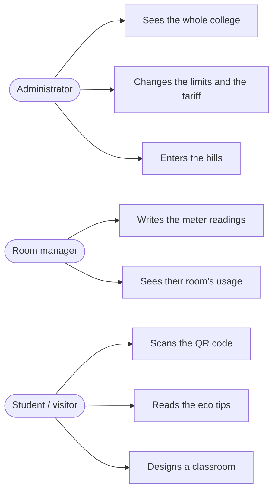

# Stage 3. The users and their needs

**Done by:** Nicoleta

The app has two users with an account and one without, who only sees the data of one room through the QR code.

| User | Who it is | What they need to do | Screens they use |
| --- | --- | --- | --- |
| Administrator | The deputy director for maintenance or the accountant | See the usage of the whole college, the cost of the month and the bills; change the limits and the tariff | Dashboard, Reports, Bills, Settings |
| Room manager | The teacher in charge of a classroom or lab | Write down the meter readings and see if their room went over the limit | Meter readings, Room page, Live monitoring |
| Student / visitor | Students, especially from the eco club | See how much the room uses and how to save | QR code on the door, Eco tips, Design the classroom |

**What everyone wants:** simple screens in Romanian, clear colors for the usage level and numbers that are easy to read.

## Test accounts

| User | Password | Role |
| --- | --- | --- |
| admin | admin123 | Administrator |
| profesor | prof123 | Room manager |
