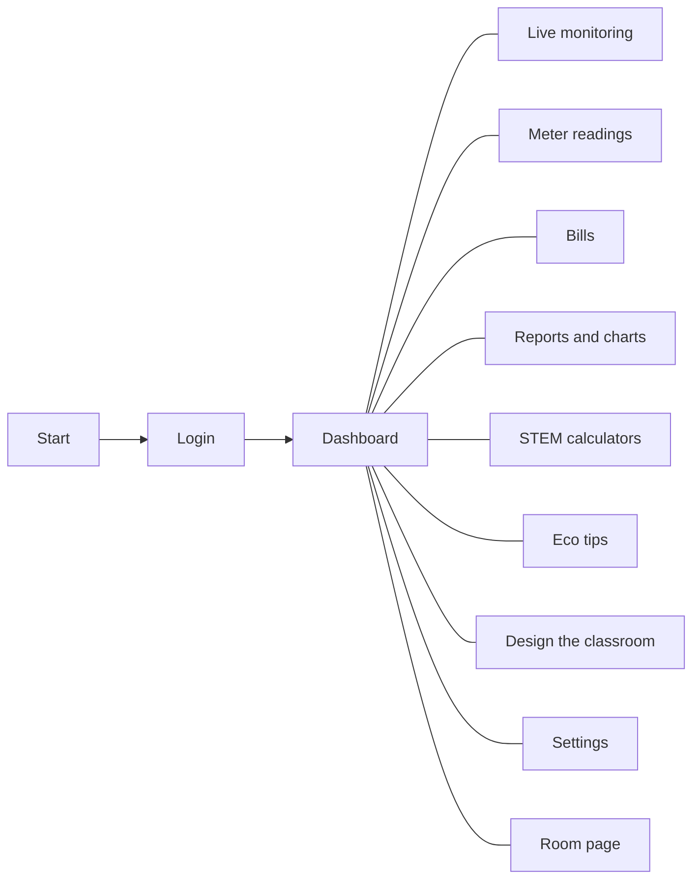

# Stage 5. App concept

**Done by:** Nicoleta

## In short

**EcoEnergie CEITI** is a desktop app that shows how much each room of the college uses, in kWh and in lei. The name comes from ecology, energy and our college.

Every room has a daily limit. The usage comes from the meter readings or from a sensor (INA219 with Arduino). The app colors the room green, yellow or red, and every room has a QR code on its door so anyone can see the usage on their phone.

## What makes it different

- a 3D model of the college, where you can click on the rooms;
- a real sensor and a live monitoring page;
- a part for students: eco tips with calculations, STEM calculators and "Design the classroom".

## Visual identity

| Element | Our choice |
| --- | --- |
| Logo | The text "ECO ⚡ ENERGIE", with the green bolt between the two words |
| Background | Almost black (#0a0a0b), dark gray cards (#121214) |
| Main color | Green (#4ade80 and #16a34a), with a gradient on the buttons |
| Usage colors | Green = normal, yellow = close to the limit, red = over the limit |
| Font | Poppins for text, a monospace font for formulas |
| Corners | Small rounding (3 px) |

## The screens

## The STEAM connection

| Component | How it shows up in the project |
| --- | --- |
| Science | Electricity and its units (W, kWh), Ohm's law, standby usage, CO₂ emissions |
| Technology | Java 21 + JavaFX app, INA219 sensor with Arduino, QR codes |
| Engineering | Three-layer architecture, the path of the data from the sensor to the screen, wiring the sensor with the 12 V bulb |
| Arts and design | A consistent interface, the color code, the logo, the 3D model of the building, the Figma mockup |
| Mathematics | Average, minimum and maximum, percent change from the previous period, bill forecast, charts |
