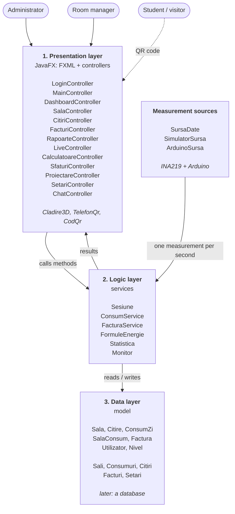
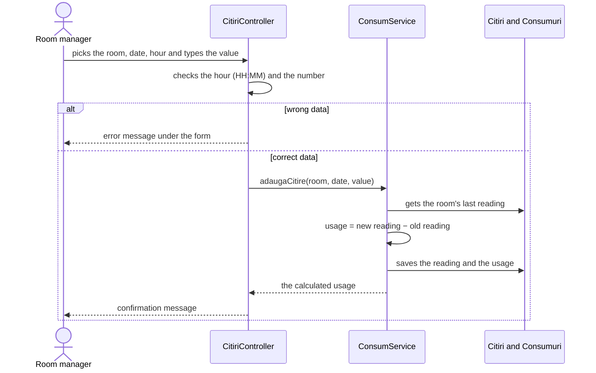
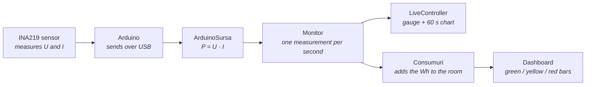
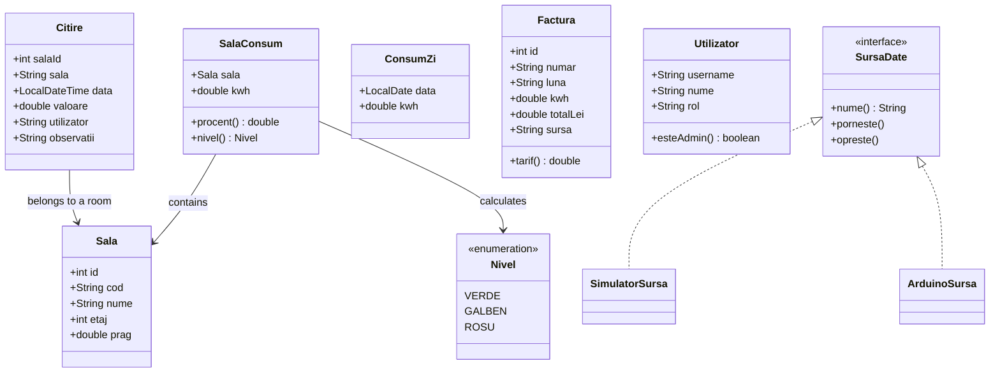

# Stage 6. App architecture

**Done by:** the whole team (we thought it through together)

The app has three layers. The screens only show the data and read what the user types. The services do the calculations and the checks. The data layer keeps the information. This way a calculation changes in one place, without touching the screens.

## 1. The three layers

| Layer | Package in the code | What it contains |
| --- | --- | --- |
| Presentation | `ui` + the `fxml` and `css` files | the screens and their controllers, the 3D model (`Cladire3D`), the QR code (`CodQr`, `TelefonQr`) |
| Logic | `service` | the calculations, data checks, live measurement |
| Data | `model` + `date` | the data classes and the lists they are kept in |
| Sources | `sursa` | where the measurements come from: simulator or Arduino |

The class and package names are in Romanian, like the app (for example `Sala` = room, `Citire` = reading, `Factura` = bill, `Consum` = usage).

## 2. The path of a meter reading

For now the data is sample data; saving to a database comes in the next stage.

## 3. The path of a sensor measurement

Without the board, `SimulatorSursa` gives values like a projector of about 240 W, and the rest of the path stays the same.

## 4. The data classes

## Libraries

| Library | What we use it for |
| --- | --- |
| JavaFX 21 | the interface, the charts, the 3D model |
| AtlantaFX | the theme (base colors of the controls) |
| Ikonli | the icons |
| TilesFX | the gauge on the live page |
| ZXing | the QR codes |
| jSerialComm | reading the Arduino data over USB |
