# Stage 10. Navigation between screens

**Done by:** Nicoleta and Faina (we worked at the same time)

The side menu is the same on every screen after login, so any page opens with one click.

```mermaid
flowchart LR
    pornire["Start"] -- "automatically, after 3 s" --> login["Login"]
    login -- "wrong data" --> eroare["Error message"]
    eroare -. "try again" .-> login
    login -- "correct data" --> panou["Dashboard"]

    panou -- "click on a room<br/>or in 3D" --> sala["Room page"]
    sala -- "Open on phone" --> qr["QR code on a phone"]
    qr -. "Close / Esc" .-> sala
    sala -. "back arrow" .-> panou

    subgraph meniu["Side menu (on every screen)"]
        direction TB
        m1["Dashboard"]
        m2["Live monitoring"]
        m3["Meter readings"]
        m4["Bills"]
        m5["Reports and charts"]
        m6["STEM calculators"]
        m7["Eco tips"]
        m8["Design the classroom"]
        m9["Settings"]
        m10["AI assistant<br/>(side panel)"]
    end

    panou --> meniu
    meniu -- "Log out" --> login
```

## Links in Figma

| From the screen | What you press | Where you get |
| --- | --- | --- |
| Start | (automatic) | Login |
| Login | Log in | Dashboard |
| Login | Log in, with wrong data | Login – error |
| Any screen | A menu button | That button's screen |
| Dashboard | A room in the list or in 3D | Room page |
| Dashboard | New reading | Meter readings |
| Dashboard | The phone button next to a room | QR code on a phone |
| Room page | Back arrow | Dashboard |
| Room page | Open on phone | QR code on a phone |
| QR code on a phone | Close | Room page |
| Meter readings | Save, with wrong data | Meter readings – error |
| Meter readings | Save, with correct data | Meter readings – confirmation |
| Any screen | Log out (bottom of the menu) | Login |
