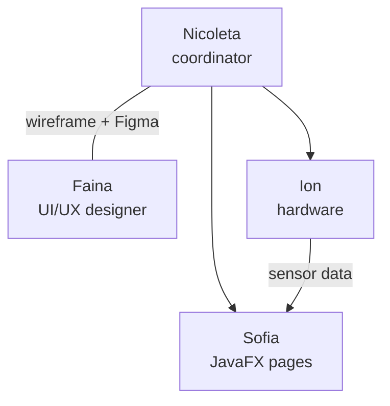

# Stage 11. Sharing the responsibilities

**Done by:** Nicoleta

## Who did what

| Member | Role | What they did |
| --- | --- | --- |
| Titei Nicoleta | Project coordinator | The wireframe and the general design in Figma (with Faina); in the app: Design the classroom (the classroom simulator), the login page and the loading page, the Dashboard with the side menu for the other pages, the side panel with the AI assistant |
| Ababii Faina | UI/UX designer | The wireframe and the general design in Figma (with Nicoleta, at the same time); in the app: Settings, Reports and charts, the Bills page |
| Goncear Sofia | JavaFX pages | Eco tips, STEM calculators, the room page that opens on click, with the QR code, the Arduino simulation page (Live monitoring), Meter readings |
| Ghinda Ion | Hardware | The Arduino board with the INA219 sensor and the 12 V bulb |

**The architecture** (stage 6) we thought through all together.

## Stages from the material

| Stage | Who |
| --- | --- |
| 1. Problem analysis | Nicoleta |
| 2. Research | everyone, individually |
| 3. Users | Nicoleta |
| 4. Requirements | Nicoleta |
| 5. Concept and STEAM | Nicoleta |
| 6. Architecture | the whole team |
| 7. Paper sketches | everyone, individually, then the team sketch |
| 8. Wireframe | Nicoleta and Faina |
| 9. Digital mockup | Nicoleta and Faina |
| 10. Navigation | Nicoleta and Faina |
| 11. Roles | Nicoleta |
| 12. Mockup check | Nicoleta and Faina |
| 13. Feedback | Nicoleta |
| 14. Improvements | Faina |
| 15. Presentation | the whole team |

